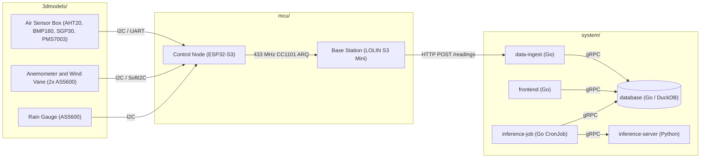

# Weather Station

End-to-end weather station with 3D-printed sensor enclosures, ESP32-S3 firmware and a microservice backend for storage, forecasting and visualization.

## Structure

- [`3dmodels/`](3dmodels/) contains CAD files and STLs for the Stevenson screen air box, anemometer and wind vane assembly and tipping-bucket rain gauge
- [`mcu/`](mcu/) contains PlatformIO firmware for the sensor mast control node and the indoor base station
- [`system/`](system/) contains the Go and Python microservices, protobuf contracts and Docker Compose and Helm deployments

## Overview

