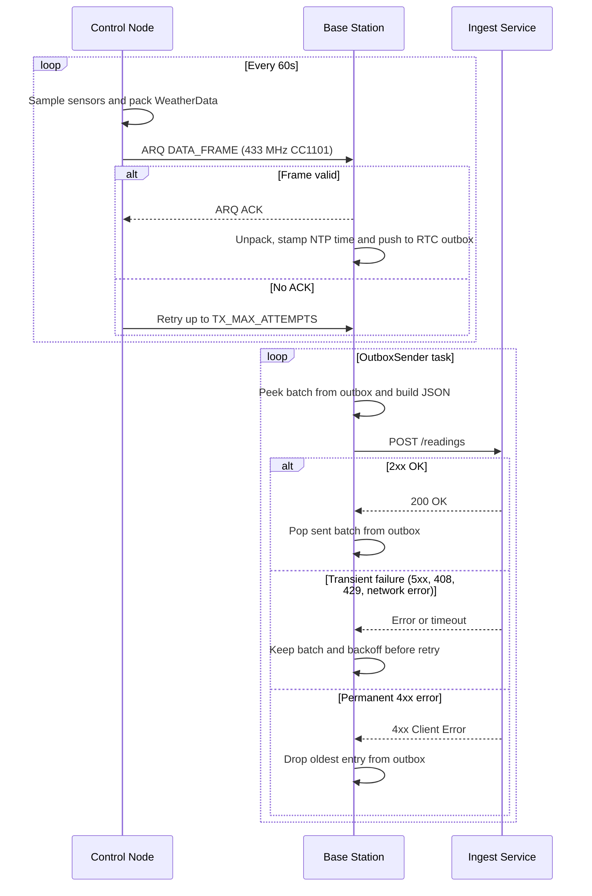

# MCU Firmware

Two ESP32-S3 boards. The control node sits at the sensor mast and sends readings
over a 433 MHz radio link. The base station receives them and posts them to the
data ingest service.

## Boards

- `control-node` (ESP32-S3 devkit) samples all weather sensors
- `base-station` (LOLIN S3 Mini) relays readings to the ingest service

Pin and policy configuration lives in `src/control-node/constants.h` and
`src/base-station/config.h`.

## Data flow

The control node gathers a reading every 60 seconds, packs it into the
fixed-point `WeatherData` struct and sends it with the ARQ protocol over
CC1101. A failed sensor is marked with a sentinel value so the receiver omits
its field from the payload.

The base station unpacks the frame, stamps it with the current NTP time and
pushes it into an outbox. A separate task builds a JSON batch and POSTs it to
the ingest `/readings` endpoint, retrying transient failures with backoff.
The outbox keeps roughly two hours of readings when the network is down.



## Flash

```bash
pio run -e control-node -e base-station
pio run -t upload -e control-node
pio run -t upload -e base-station
```
