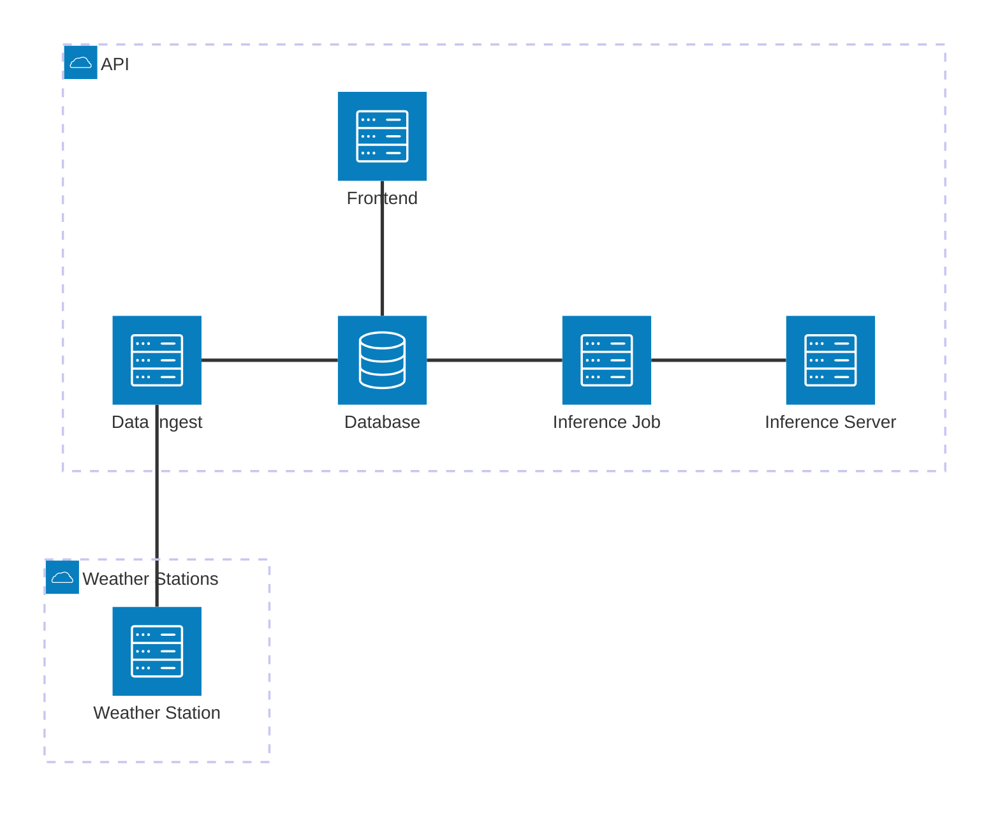

# Backend & Frontend for the Weather Station

This folder contains the backend and frontend for the weather station.

It uses a microservice architecture with gRPC being used to communicate between services.

## Repository layout

This is a multi-module Go workspace (`go.work`) with a Python inference server and a single source of truth for protobuf contracts.

```
system/
├── go.work                    # wires the Go modules together
├── proto/                     # single source of truth for .proto files
│   ├── buf.yaml               # lint & breaking-change config
│   ├── buf.gen.yaml           # codegen plugins (Go + Python)
│   ├── weather/.../*.proto    # service contracts
│   └── gen/                   # generated stubs (committed)
│       ├── go/                #   Go module weather-station/gen/go
│       └── python/            #   Python protobuf and gRPC stubs
├── go/
│   ├── common/                # shared infrastructure module
│   │   ├── server/            #   shared HTTP + gRPC servers
│   │   ├── client/            #   shared HTTP + gRPC clients
│   │   ├── health/            #   shared health and readiness checks (HTTP + gRPC)
│   │   └── fxgroup/           #   shared helpers for tagging handlers into fx groups
│   ├── database/              # service (duckdb storage)
│   ├── data-ingest/           # service (ingests MCU data)
│   ├── frontend/              # service (HTTP for data)
│   └── inference-job/         # service (cron prediction)
└── python/
    └── inference-server/        # Python inference server (timestral / chronos-2)
```

## Infrastructure

- `database` (golang): database interface for weather ground and prediction data
- `frontend` (golang): http interface for the data
- `data-ingest` (golang): ingest service for the data coming from the MCU
- `inference-job` (golang): cron-job that retrieves data from database and predicts the future weather
- `inference-server` (python): inference server for time series forecasting, with pluggable model backends (timestral by default, chronos-2 available). This is split from `inference-job` to allow it to be deployed on more performant nodes or to be replaced with commercial services.




## Docker Images

Build commands run from the `system/` directory.

### Go Microservices

Build any Go microservice by passing `SERVICE` (`data-ingest`, `database`, `frontend`, `inference-job`).

```bash
docker build -f go/Dockerfile --build-arg SERVICE=data-ingest -t weather-station/data-ingest .
```

### Python Inference Server

Build the Chronos-2 inference server.

```bash
docker build -f python/inference-server/Dockerfile -t weather-station/inference-server .
```
