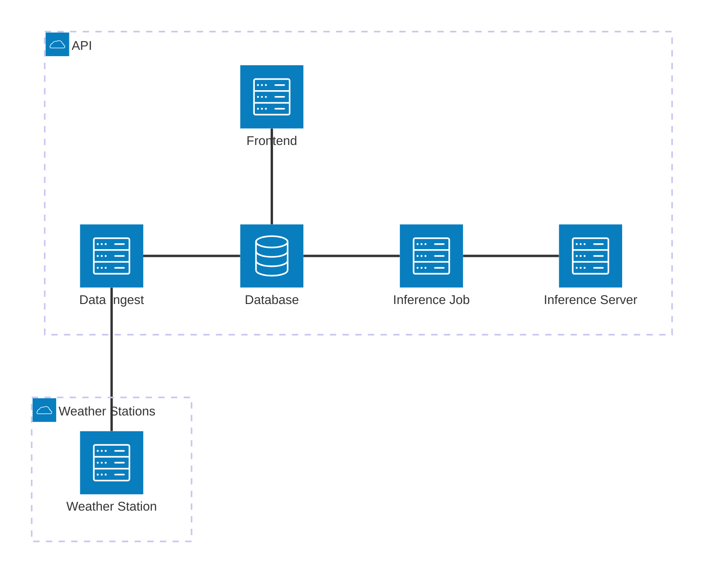

# Backend & Frontend for the Weather Station

This folder contains the backend and frontend for the weather station.

It uses a microservice architecture with gRPC being used to communicate between services.

## Repository layout

This is a multi-module Go workspace (`go.work`) with a Python inference server and a single source of truth for protobuf contracts.

```
system/
├── go.work                    # wires the Go modules together
├── proto/                     # single source of truth for .proto files
│   ├── buf.yaml               
│   ├── buf.gen.yaml           
│   ├── weather/.../*.proto    # service contracts
│   └── gen/                   # generated stubs (committed)
│       ├── go/                
│       └── python/            
├── go/
│   ├── common/                # shared infrastructure module
│   ├── database/              # service (duckdb storage)
│   ├── data-ingest/           # service (ingests MCU data)
│   ├── frontend/              # service (HTTP for data)
│   └── inference-job/         # service (cron job to run inference)
└── python/
    └── inference-server/        # Python time series inference server
```

## Infrastructure

- `database` (golang): database interface for weather ground and prediction data
- `frontend` (golang): http interface for the data
- `data-ingest` (golang): ingest service for the data coming from the MCU
- `inference-job` (golang): cron-job that retrieves data from database and predicts the future weather
- `inference-server` (python): inference server for time series forecasting, with pluggable model backends (timestral by default, chronos-2 available).



